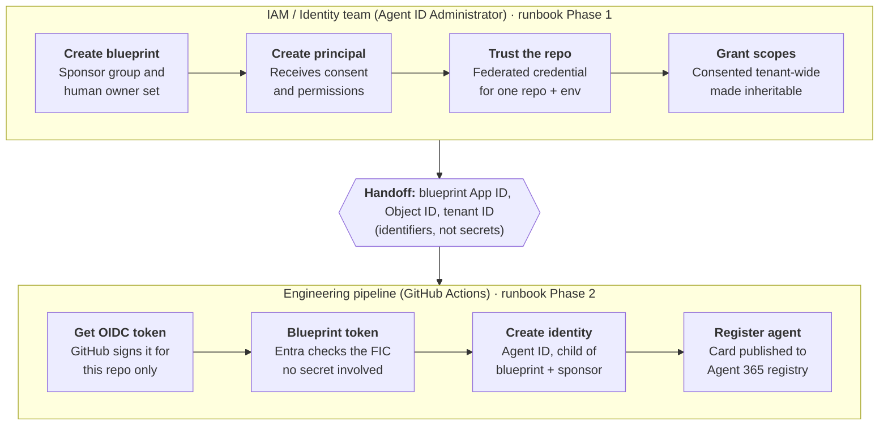

# Agent Identity Demo: IAM creates the blueprint, engineering creates the agents

This demo shows that an enterprise's **IAM team can create agent blueprints and hand only the blueprint ID to engineering, who then create agent identities themselves**. It works end to end on Microsoft Entra Agent ID and Agent 365, and engineering never gets identity privileges or credentials.

**The blocker it solves.** Most guidance assumes one person runs `a365 setup all` end to end, which puts blueprint creation and credentials in the developer's hands. Customers with a strict security model can't allow that. This repo proves **centralized provisioning** works: IAM owns every security-sensitive object, and the engineering pipeline can only use what IAM pre-authorized.

This repo is the **engineering side**: a GitHub Actions workflow. The **IAM side** is a step-by-step runbook: [docs/option1-agent-provisioning-runbook.md](./docs/option1-agent-provisioning-runbook.md). The sample agent is a "Contoso Sales Assistant" with email, calendar and Teams skills.

## How it works

IAM does its four steps once per blueprint. After that, every run of the engineering pipeline can create and register agents with no further IAM ticket.

The trust between the two teams is a **federated identity credential (FIC)**, not a password. IAM configures Entra to accept tokens that GitHub signs for one specific repo and environment. No credential ever changes hands, and knowing the blueprint IDs alone grants nothing.

## Key value props

| Value prop | What it means for the customer |
| --- | --- |
| **Separation of duties, enforced by the platform** | IAM creates the blueprint, credentials, scopes and consent. Engineering creates only the agent identity and its registry card. The pipeline cannot exceed what IAM approved. |
| **No credentials handed to engineering** | Engineering authenticates through GitHub OIDC and a federated credential. There is no secret to email, store, rotate or leak. A client secret is optional and only for local testing. |
| **Governance from the first object** | Every blueprint has a sponsor group and a human owner. Every agent is a child of an approved blueprint and is registered in Agent 365, so no agent exists outside IAM's view. |
| **One explicit consent decision** | Tenant-wide consent happens once per blueprint. The customer chooses whether it's automated by IAM's app or clicked by a Global Admin, and the runbook spells out the risk of each. |
| **Self-service at scale** | After the one-time IAM setup, engineering creates the 1st or the 50th agent from a pipeline with no further tickets. |
| **Real-world runbook** | The runbook documents gotchas the docs don't cover yet: sponsor group types, silent `noScopes` failures, and GitHub's immutable OIDC subject claims (repos created on or after July 15, 2026). |

## When to use this model

Use the centralized model whenever the IAM team says engineering must not create or hold identity objects. That's typically regulated industries, central identity governance teams, and anyone who rejects a developer running `a365 setup all`.

| | Centralized (this repo) | Developer self-service (`a365` CLI) |
| --- | --- | --- |
| Who creates the blueprint and credentials | IAM, through Graph or the Entra admin center | Developer, through the `a365` CLI |
| What engineering receives | Blueprint IDs only | The Agent ID Developer role |
| Separation of duties | Strongest: engineering never sees a secret | Strong: consent and inheritable permissions stay with admins |
| Best for | Regulated tenants, central identity governance | Fast, developer-led teams and demo tenants |

## Getting started (engineering side)

This assumes IAM has finished [Phase 1 of the runbook](./docs/option1-agent-provisioning-runbook.md).

### What you receive from IAM

Receive these over a secure channel. Never paste them into this repo or a chat.

| Value | Where it goes |
| --- | --- |
| Blueprint **App ID** (`appId`) | `AGENT_BLUEPRINT_APP_ID` repo variable |
| Blueprint **Object ID** (`id`) | `AGENT_BLUEPRINT_OBJECT_ID` repo variable |
| Tenant ID | `TENANT_ID` repo variable |
| Sponsor group ID (M365 group) | `AGENT_SPONSOR_GROUP_ID` repo variable. Required: identity creation fails without a sponsor. |
| *(fallback only)* client secret | `AGENT_BLUEPRINT_SECRET` repo **secret**. Only needed if IAM didn't set up the federated credential. |

Only the fallback secret is sensitive. The IDs can be looked up through Graph anyway, but keep them in repo variables, not in code or commit history.

### One-time repo setup

1. **Settings → Secrets and variables → Actions → Variables**: add `AGENT_BLUEPRINT_APP_ID`, `AGENT_BLUEPRINT_OBJECT_ID`, `TENANT_ID` and `AGENT_SPONSOR_GROUP_ID`.
2. **Settings → Environments**: create an environment named `production`. It must match the federated credential IAM configured on the blueprint.
3. *(Fallback only)* **Settings → Secrets and variables → Actions → Secrets**: add `AGENT_BLUEPRINT_SECRET`.
4. Confirm with IAM that the federated credential matches your repo and environment exactly. A mismatch is the most common first-run failure (`AADSTS70021` / `AADSTS700213`). Repos created on or after July 15, 2026 need a `claimsMatchingExpression` (see Step 1.3 of the runbook).

### Running it

- **Automatically:** every push to `main` runs [`.github/workflows/register-agent.yml`](./.github/workflows/register-agent.yml).
- **Manually:** Actions tab → **Register and activate agent identity** → **Run workflow**.
- **Locally:** [`scripts/local-test.sh`](./scripts/local-test.sh) uses the fallback secret to create a test identity outside CI.

The workflow:

1. Requests a GitHub OIDC token.
2. Exchanges it for a Graph token, authenticating **as the blueprint**. No secret is involved on the FIC path.
3. Calls `POST /beta/serviceprincipals/Microsoft.Graph.AgentIdentity` to create the agent identity as a child of the blueprint.
4. Calls `POST /beta/copilot/agentRegistrations` to publish the agent card and bring the agent online in the Agent 365 registry.

### What this repo can and can't do

The pipeline can only do what the blueprint's inheritable permissions and tenant-wide consent already allow. It cannot request new scopes, add credentials or widen its own access. If an agent needs an API it can't call, request the change from IAM.

## Known gaps and next steps

The core handoff works. These items stand between the demo and production use:

- [ ] **Make the workflow idempotent.** Every push to `main` creates a new agent identity, so it should check for an existing one first.
- [ ] **Confirm registration permissions.** The blueprint token needs `AgentRegistration.ReadWrite.All` for the registry call. The current scopes cover only Mail, Calendar and Teams.
- [ ] **Add observability.** The Microsoft OpenTelemetry Distro and the `Agent365.Observability.OtelWrite` grant are mandatory for Agent 365, and the demo doesn't include them yet.
- [ ] **Track the `/beta` APIs.** Both Graph calls are preview endpoints, so check them against current docs before any production use.
